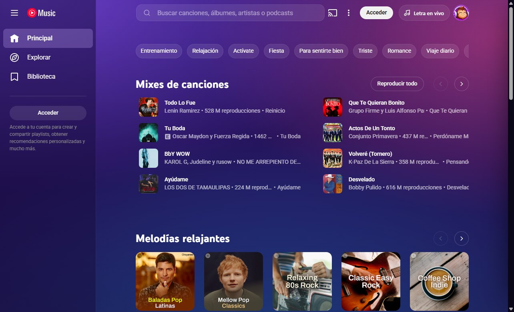
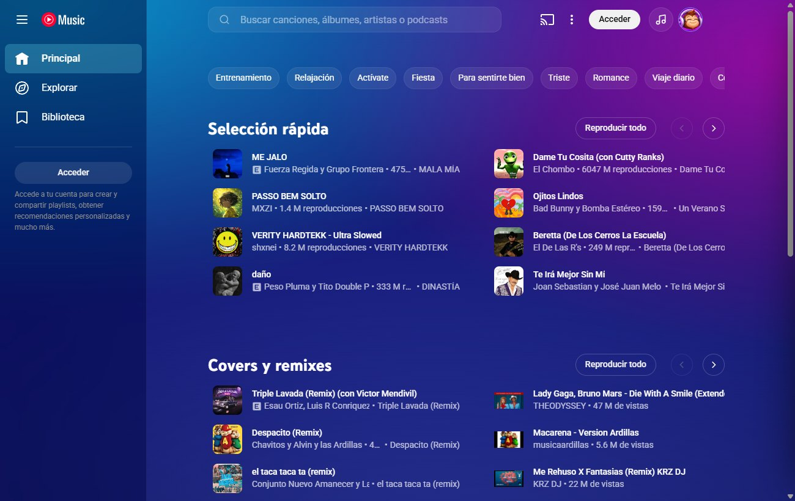
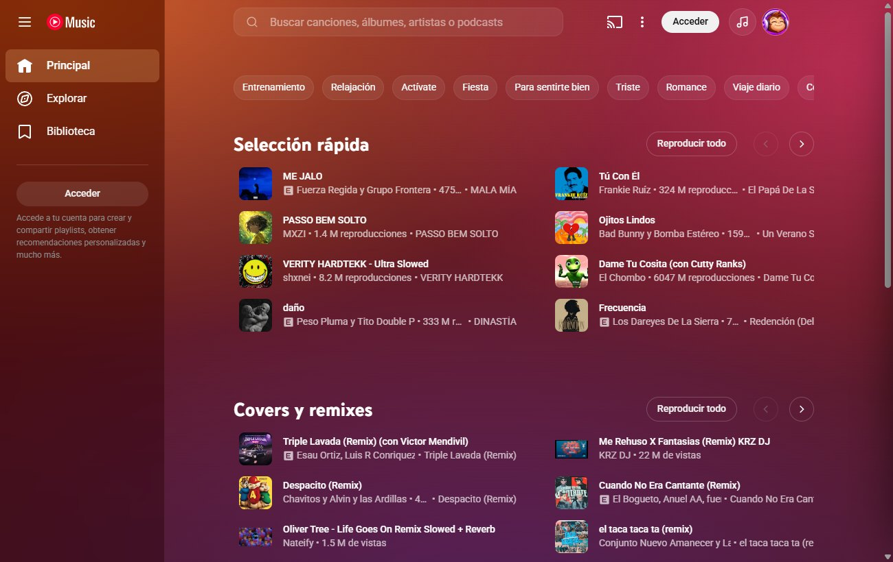

<p align="center">
  
</p>

<h1 align="center">MoniMusic</h1>

<p align="center"><b>YouTube Music, con tu estilo.</b><br>
Toma el color de la portada que suena, le suma letra que sigue la canción y un panel para diseñar tu reproductor.</p>

<p align="center">
  <a href="https://monim.moonryx.com">Sitio</a> ·
  <a href="https://github.com/moonryx/MoniMusic/releases/latest">Descargar</a> ·
  <a href="https://moonryx.com">Moonryx</a>
</p>



## Qué hace

- **El color sale de la portada.** El fondo, las barras y los detalles se tiñen con la portada de la canción actual.
- **Letra en vivo.** Resalta la línea que suena; al tocar una línea, la canción salta a esa parte (`Alt + L`).
- **Panel de diseño.** Temas, color de acento, fondo, redondez y tipografía, con cambios al instante (`Ctrl + ,`).
- **Modo rápido.** Sin efectos pesados por defecto; el acabado de cristal es opcional.
- **Tu cuenta de siempre.** Es YouTube Music de verdad: tu biblioteca, tus playlists y tu plan.

| Neón | Atardecer |
| --- | --- |
|  |  |

## Instalar en Windows

1. Descarga el ZIP de la [última versión](https://github.com/moonryx/MoniMusic/releases/latest) y descomprímelo completo.
2. Doble clic en **Instalar MoniMusic.cmd**.
3. Abre **MoniMusic** desde el escritorio o el menú Inicio e inicia sesión con Google una vez.

Necesita Windows 10 u 11 con Microsoft Edge (viene con Windows) o Brave. El instalador no pide permisos de
administrador y no está firmado, así que Windows puede mostrar un aviso antes de abrirlo. Todo lo que hace
está en [`instalador/instalar.ps1`](instalador/instalar.ps1): copia la extensión a `%LOCALAPPDATA%\MoniMusic`
y crea los accesos directos.

MoniMusic se abre en una ventana propia que usa el motor de Edge con un perfil aparte. Por eso el inicio de
sesión de Google funciona: es un navegador real, no uno incrustado.

## Usarla como extensión

También funciona dentro de Chrome, Edge, Brave u Opera, con la sesión que ya tengas:

1. Abre `chrome://extensions` (o `edge://extensions`, `opera://extensions`).
2. Activa **Modo de desarrollador**.
3. Pulsa **Cargar descomprimida** y elige la carpeta [`extension`](extension).
4. Abre [music.youtube.com](https://music.youtube.com).

## Privacidad

MoniMusic no tiene cuentas propias ni analítica. Los ajustes de diseño se guardan en tu equipo.
Para buscar la letra se envían el título, el artista y la duración de la canción a [LRCLIB](https://lrclib.net),
un servicio público de letras con tiempos. Nada más sale de tu máquina.

## Desarrollo

```bash
npm install
npm run extension   # genera ./extension a partir del código fuente
npm run instalar    # instala la app en este equipo (con MoniMusic cerrada)
npm run release     # arma dist/MoniMusic-<versión>-windows.zip
```

| Archivo | Para qué sirve |
| --- | --- |
| `preload.js` | Lo que corre dentro de YouTube Music: fondo de portada, panel de diseño y letra en vivo. |
| `theme.css` | El tema. Todo sale de variables `--mk-*` que el panel cambia en vivo. |
| `panel.css` | Botones de la barra, panel de diseño y vista de la letra. |
| `main.js` | Ventana de pruebas con Electron y la búsqueda de letras (LRCLIB). |
| `tools/build-extension.js` | Convierte lo anterior en la extensión (`extension/`). No edites esa carpeta a mano. |
| `tools/install.js` | Instala la app en tu equipo. |
| `tools/build-release.js` | Arma el ZIP de descarga con el instalador de `instalador/`. |

Para probar un cambio sin tocar tu sesión, hay una ventana de pruebas con perfil temporal que guarda una captura:

```bash
npx electron . --shot=captura.png --shot-ext=extension --shot-size=1300x820
```

La versión con Electron ya no se usa para instalar: Google rechaza el inicio de sesión en navegadores incrustados.

## Aviso

MoniMusic es un proyecto independiente de [Moonryx](https://moonryx.com). No está afiliado a YouTube ni a Google,
ni cuenta con su respaldo. YouTube y YouTube Music son marcas de Google LLC. MoniMusic no quita anuncios ni
cambia lo que incluye tu plan.

## Licencia

[MIT](LICENSE)
