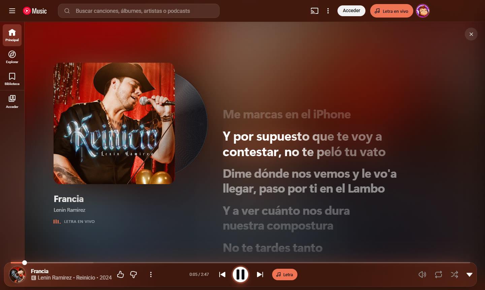
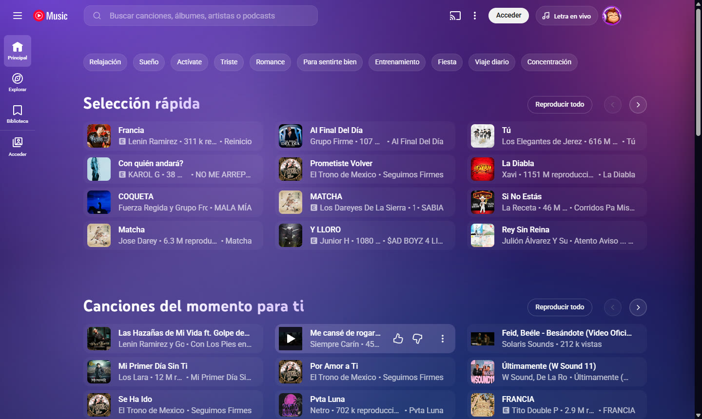
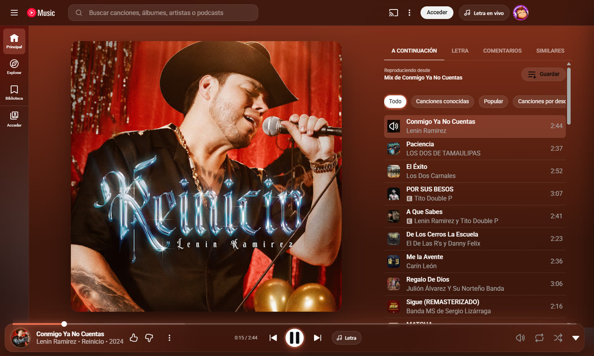

<p align="center">
  
</p>

<h1 align="center">MoniMusic</h1>

<p align="center"><b>YouTube Music, con tu estilo.</b><br>
Toma el color de la portada que suena, le suma letra que sigue la canción y un panel para diseñar tu reproductor.</p>

<p align="center">
  <a href="https://monim.moonryx.com">Sitio</a> ·
  <a href="https://github.com/moonryx/MoniMusic/releases/latest">Descargar</a> ·
  <a href="https://moonryx.com">Moonryx</a>
</p>



## Qué hace

- **El color sale de la portada.** El fondo, las barras y hasta la barra de título de la ventana se tiñen con la canción actual.
- **El fondo baila con la música.** Las manchas de color laten con cada golpe y se mueven más rápido mientras más movida es la canción.
- **Letra en vivo.** La línea que suena se va llenando de luz; al tocar una línea, la canción salta a esa parte (`Ctrl + L`).
- **Panel de diseño.** Temas, color de acento, fondo, movimiento, redondez y tipografía, con cambios al instante (`Ctrl + ,`).
- **Tu cuenta de siempre.** Es YouTube Music de verdad: tu biblioteca, tus playlists y tu plan.

| Inicio | Ahora suena |
| --- | --- |
|  |  |

## Instalar en Windows

1. Descarga `MoniMusic-<versión>-windows.zip` de la [última versión](https://github.com/moonryx/MoniMusic/releases/latest) y descomprímelo completo.
2. Doble clic en **Instalar MoniMusic.cmd**.
3. Abre **MoniMusic** desde el escritorio o el menú Inicio e inicia sesión con Google una vez.

Funciona en Windows 10 y 11 con el motor WebView2 de Microsoft, que ya viene con Windows 11 y con Edge en
Windows 10. El instalador no pide permisos de administrador: copia la app a `%LOCALAPPDATA%\MoniMusic` y crea
los accesos directos. Todo lo que hace está en [`instalador/instalar.ps1`](instalador/instalar.ps1).

MoniMusic no está firmada, así que Windows puede mostrar un aviso la primera vez. Con el Control de
aplicaciones inteligente activado, Windows puede no dejarla abrir.

## Usarla como extensión

También funciona dentro de Chrome, Edge, Brave u Opera, con la sesión que ya tengas:

1. Descarga `MoniMusic-<versión>-extension.zip` de la [última versión](https://github.com/moonryx/MoniMusic/releases/latest) y descomprímelo.
2. Abre `chrome://extensions` (o `edge://extensions`, `opera://extensions`) y activa **Modo de desarrollador**.
3. Pulsa **Cargar descomprimida** y elige la carpeta que descomprimiste.
4. Abre [music.youtube.com](https://music.youtube.com).

En la extensión la letra se abre con `Alt + L`.

## Privacidad

MoniMusic no tiene cuentas propias ni analítica. Los ajustes de diseño se guardan en tu equipo.
Para buscar la letra se envían el título, el artista y la duración de la canción a [LRCLIB](https://lrclib.net),
un servicio público de letras con tiempos. El sonido para mover el fondo se mide en tu equipo y no se envía a
ningún lado.

## Desarrollo

La interfaz es una sola: `preload.js`, `theme.css` y `panel.css`. De ahí salen la app y la extensión.

| Archivo | Para qué sirve |
| --- | --- |
| `preload.js` | Lo que corre dentro de YouTube Music: fondo, panel de diseño, letra en vivo y botones. |
| `theme.css` | El tema. Todo sale de variables `--mk-*` que el panel cambia en vivo. |
| `panel.css` | Botones, panel de diseño y vista de la letra. |
| `main.js` | La búsqueda de letras (LRCLIB) y una ventana de pruebas con Electron. |
| `app/` | La app de escritorio en Rust (Tauri): abre YouTube Music y le inyecta la interfaz. |
| `tools/build-app.js` | Genera `app/src/inject.js` a partir de la interfaz. |
| `tools/build-extension.js` | Genera la extensión (`extension/`). No edites esa carpeta a mano. |
| `tools/build-release.js` | Arma los ZIP de descarga. |

La app se compila en GitHub Actions ([`.github/workflows/app.yml`](.github/workflows/app.yml)) con cada cambio
en la interfaz o en `app/`; el ejecutable queda como artefacto `MoniMusic-windows`. Para armar una versión:

```bash
npm run release -- --exe=ruta/a/monimusic.exe   # dist/MoniMusic-<versión>-windows.zip y -extension.zip
```

Si junto a `MoniMusic.exe` hay un `inject.js` más nuevo que el que trae dentro, la app usa ese: así se prueba
un cambio de interfaz sin compilar de nuevo (`npm run app:inject` y copiar `app/src/inject.js`).

Para probar sin tocar tu sesión hay una ventana de pruebas con perfil temporal que guarda una captura. Los guiones
de [`tools/pruebas`](tools/pruebas) ponen a sonar una canción y revisan cada parte:

```bash
npx electron . --shot=captura.png --shot-eval=tools/pruebas/letra.js --shot-size=1500x900
```

## Aviso

MoniMusic es un proyecto independiente de [Moonryx](https://moonryx.com). No está afiliado a YouTube ni a Google,
ni cuenta con su respaldo. YouTube y YouTube Music son marcas de Google LLC. MoniMusic no quita anuncios ni
cambia lo que incluye tu plan.

## Licencia

[MIT](LICENSE)
